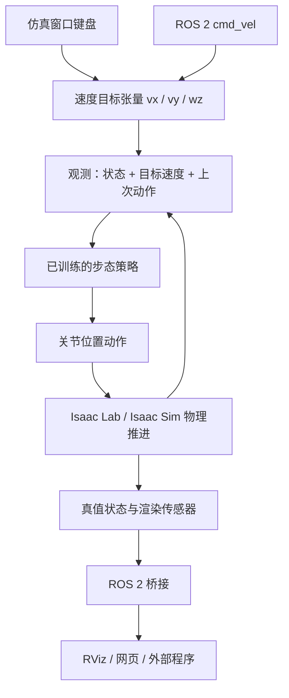
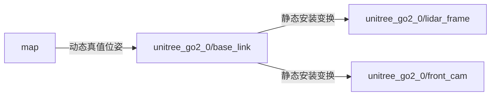
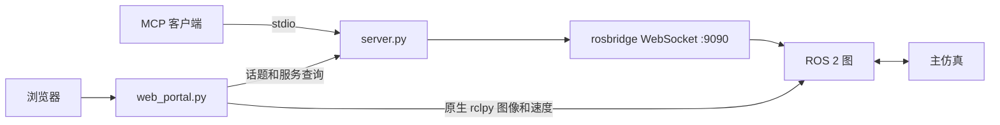

# Go2 / Spot 仿真项目详尽中文指南

本文面向“熟悉 Python，但刚接触机器人仿真”的读者。内容按当前仓库的实际调用关系编写，覆盖运行入口、物理仿真、策略推理、传感器、ROS 2、网页和 MCP。原有 [README.md](README.md) 与 [MCP 说明](ros-mcp-server/README_MCP.md) 可用于查看上游介绍和效果图。

这里的“当前实现”指本次阅读的源码，不代表已经在目标 GPU、Isaac Sim 和 ROS 环境中完成实机运行验证。文中列出的现有差异用于帮助理解和排错。

## 目录

1. [这个项目在做什么](#1-这个项目在做什么)
2. [先掌握这些仿真概念](#2-先掌握这些仿真概念)
3. [目录与建议阅读顺序](#3-目录与建议阅读顺序)
4. [从启动到机器人迈步](#4-从启动到机器人迈步)
5. [物理时间控制时间和真实时间](#5-物理时间控制时间和真实时间)
6. [机器人状态动作和预训练策略](#6-机器人状态动作和预训练策略)
7. [场景地形和多机器人](#7-场景地形和多机器人)
8. [相机雷达和语义数据](#8-相机雷达和语义数据)
9. [ROS-2-话题坐标系和时钟](#9-ros-2-话题坐标系和时钟)
10. [安装和首次运行](#10-安装和首次运行)
11. [配置逐项说明](#11-配置逐项说明)
12. [网页和-MCP-模块](#12-网页和-mcp-模块)
13. [现有实现的边界与排错](#13-现有实现的边界与排错)
14. [学习路线与后续实验](#14-学习路线与后续实验)

## 1. 这个项目在做什么

项目在 NVIDIA Isaac Sim 中创建 Unitree Go2 或 Boston Dynamics Spot 四足机器人，借助 Isaac Lab 管理机器人状态与物理步进，加载已有的强化学习策略让机器人跟踪目标速度，再把位姿、点云、图像等数据发布到 ROS 2。目标速度可以来自仿真窗口键盘，也可以来自 ROS 2 话题；附带的网页和 MCP 工具提供了其他输入和观察入口。

当前 `main.py` 做的是**预训练策略推理**。代码虽然创建了 PPO Runner，配置中也有学习率、奖励算法相关参数，但主循环没有调用训练更新。它没有在运行时重新学习走路。



“给机器人前进速度”与“控制每个关节”是两个层级：你给出的是机身速度愿望，策略根据当前姿态生成腿部动作，实际能否达到愿望取决于模型能力、地形和物理条件。代码没有根据相机或点云自动规划绕障路线，YOLO 也没有接入步态网络的输入。

## 2. 先掌握这些仿真概念

| 概念 | 在本项目里的含义 | 可借助的 Python 理解方式 |
| --- | --- | --- |
| Isaac Sim | 提供物理引擎、渲染、USD 场景和扩展运行环境 | 一个需要先启动的应用运行时 |
| Isaac Lab | 在 Sim 上管理场景、批量状态、动作与强化学习环境 | 面向机器人任务的框架层 |
| USD / Stage | 场景描述格式及正在使用的场景树 | 类似包含资产引用的对象树，但同时保存几何、材质和物理属性 |
| prim | 场景树上的节点，如刚体、相机或变换节点 | 有唯一场景路径的对象 |
| Xform | 携带位置、旋转、缩放的场景节点 | 组合变换的容器 |
| Articulation | 用关节连接起来的多个刚体，如机器人躯干和腿 | 带约束和执行器的刚体系统 |
| 刚体 / 碰撞体 | 刚体参与动力学，碰撞体描述接触形状 | 视觉网格与碰撞形状可以不同 |
| 执行器 | 根据目标与状态产生驱动力或力矩 | 关节目标跟踪器，具体参数来自机器人资产配置 |
| observation | 策略每次决策收到的数值状态 | 形状通常为 `(num_envs, obs_dim)` 的张量 |
| action | 策略输出、交给动作管理器的控制量 | 形状通常为 `(num_envs, action_dim)` 的张量 |
| policy | 从观测计算动作的已训练模型 | 可调用对象 `actions = policy(obs)` |
| render product | 传感器渲染输出通道 | 后续读取器或 writer 挂接的数据源 |
| annotator / writer | 前者读取渲染结果，后者输出数据，例如 ROS 图像 | 数据提取器和输出适配器 |
| ROS 节点 / 话题 | 节点是通信参与者，话题是带消息类型的数据流 | 发布订阅通信，跨进程传输结构化数据 |
| TF | 带名字的坐标系之间的变换关系 | 位置与方向的变换图，不会移动仿真中的物体 |

三类路径尤其容易混淆：

```text
磁盘文件：ckpts/unitree_go2/flat_model_6800.pt
USD prim：/World/envs/env_0/Go2/base/front_cam
ROS 话题：/unitree_go2_0/front_cam/color_image
```

这三者分别用于读取文件、定位场景对象和路由消息。ROS 中的 `frame_id` 又是坐标系名称，通常也不是 USD 路径。

项目中的位置和平移一般用米，线速度用米/秒，角速度用弧度/秒。机身速度 `[vx, vy, wz]` 通常表示前进、左移和绕竖直轴左转。世界系描述机器人在场地中的状态，机身系随机器人旋转；机器人转身后，机身前向也跟着转。

## 3. 目录与建议阅读顺序

```text
Go2_Isaac_ros2/
├── main.py                      # 应用启动、配置装配与主循环
├── cfg/sim.yaml                 # 机器人、场景、数量、频率与发布开关
├── env/
│   ├── sim_env.py               # 引用预制场景或导入生成的障碍地形
│   ├── terrain.py               # 矩形障碍高度场采样
│   └── terrain_cfg.py           # 自定义高度场配置结构
├── quadruped/
│   ├── go2/
│   │   ├── go2_env.py           # 资产、状态、动作、时间步和 GUI 跟随
│   │   ├── go2_ctrl.py          # 目标速度、键盘处理和权重加载
│   │   ├── go2_ctrl_cfg.py      # RSL-RL 网络和检查点配置
│   │   └── go2_sensors.py       # 前置相机及 RTX 雷达创建
│   └── spot/                   # Spot 对应实现
├── ros2/
│   ├── go2_ros2_bridge.py       # Go2 消息、TF、图像管线及 YOLO
│   └── spot_ros2_bridge.py      # Spot 对应桥接
├── ckpts/
│   ├── unitree_go2/             # 平地与粗糙地形模型
│   ├── bd_spot/                 # Spot 模型
│   └── yolo/                   # yolov8n.pt
├── rviz/                       # Go2 和 Spot 的 RViz 配置
├── ros-mcp-server/             # 可选网页、MCP 和 rosbridge 客户端
│   ├── server.py               # stdio MCP 工具注册
│   ├── config.py               # 网页、模型服务、ROS 话题及网络配置
│   ├── web_portal.py           # Gradio 页面与线程启动
│   ├── utils/                 # WebSocket、话题、服务、网络检查
│   └── web_utils/             # 图像缓存、控制、描述与关系图
├── requirements.txt            # 仿真框架之外的部分 Python 依赖
└── media/                      # 效果图和演示动画
```

机器人 USD 和关节执行器定义主要由 `isaaclab_assets` 提供，并未全部放在本仓库。要理解质量、摩擦、关节限位、PD 增益等具体数值，需要继续追踪 `UNITREE_GO2_CFG` 或 `SPOT_CFG` 及其资产引用。

建议按 `cfg/sim.yaml` → `main.py` → `go2_ctrl.py` → `go2_env.py` → `go2_sensors.py` → `go2_ros2_bridge.py` 的顺序阅读。先理解一条 Go2 路径，再比较 Spot 的差异，最后看网页与 MCP。

## 4. 从启动到机器人迈步

1. `main.py` 解析 `AppLauncher` 命令行参数并启动 Isaac 应用。依赖 Kit 扩展的机器人、相机和桥接模块随后导入。
2. Hydra 读取 `cfg/sim.yaml`，调用 `main(cfg)`。注意：应用已启动，因此文件里的 `sim_app` 字段没有在本入口传给 `AppLauncher`。
3. 根据 `cfg.robot` 创建 Go2 或 Spot 环境配置，设置实例数量，并根据目标频率计算 `decimation`。
4. 初始化零速度张量，调用对应的 `get_rsl_flat_policy`。函数创建 Gymnasium 任务，包装为 RSL-RL 接口，构建网络，加载权重并返回策略。
5. 按 `env_name` 加载额外场景，再安装各机器人的雷达和相机。
6. 订阅窗口键盘，初始化 rclpy，创建 `RobotDataManager`，建立时钟、TF、发布器、订阅器以及图像输出管线。
7. `env.reset()` 返回初始观测，之后每次循环依次执行策略推理、环境步进、数据发布检查、ROS 回调处理、可选视角跟随和等待。
8. 正常退出路径销毁 ROS 节点、关闭 ROS 和仿真应用。当前清理代码不在 `try/finally` 中，异常中断时不保证执行完毕。

`torch.inference_mode()` 禁用用于训练的梯度追踪等开销。它不会训练模型，也不会让物理仿真脱离 `env.step` 自行前进。

ROS 回调在 `env.step` 之后执行。速度消息先修改共享张量，观测管理器在后续计算观测时读取它，再由策略使用，因此不能把“消息收到”和“关节立即改变”当作同一时刻。

## 5. 物理时间、控制时间和真实时间

当前机器人环境设置 `sim.dt = 0.005` 秒，即物理求解目标为每仿真秒 200 步。策略不必每个物理步重新推理，`decimation` 指一个环境动作持续多少个物理步。

```text
物理频率 = 1 / dt = 200 Hz
decimation = ceil(1 / dt / cfg.freq)
一次 env.step 推进的时间 = dt × decimation
实际设定的控制频率 = 1 / (dt × decimation)
```

当 `freq=40` 时，`decimation=5`，一次动作推进 0.025 仿真秒。若 `freq=60`，向上取整得到 4，实际控制频率为 50 Hz。原配置建议选用 200 的约数，原因在这里。

三种“频率”需要分别理解：

| 事项 | 当前设置 | 实际限制 |
| --- | --- | --- |
| 物理求解 | 200 Hz 仿真时间 | 真实每秒能算多少步取决于硬件和负载 |
| 策略 / 主循环 | 由 `freq` 换算 | 受推理、渲染、消息转换和 YOLO 耗时影响 |
| 状态发布 | 目标 50 Hz 墙上时间 | 每次主循环检查，40 Hz 循环无法发布到 50 Hz |
| 雷达发布 | 目标 15 Hz 墙上时间 | 到期后等下次主循环，实际间隔会量化 |
| 相机 | 创建时使用 `cfg.freq` | 还受渲染调度和发布 gate 控制 |
| 网页速度发送 | 10 Hz | 独立于仿真频率 |

主循环只在执行时间小于目标步长时 `sleep`。执行时间已经超出时，它不会跳过物理步骤追赶真实时间，因此可能出现慢速仿真。

ROS 消息时间戳取自节点时钟；状态和雷达的发送节流却用 `time.time()`。当仿真慢于真实时间时，两种时钟的推进速度不同。`/clock` 用于告诉下游“现在的仿真时间”，需要使用仿真时间的下游节点也应设置 `use_sim_time=true`。

## 6. 机器人状态、动作和预训练策略

### 6.1 速度目标如何进入网络

`base_vel_cmd_input` 的形状是 `(num_envs, 3)`。每一行属于一台机器人，每一列分别是 `vx`、`vy`、`wz`。

`base_vel_cmd(env)` 复制张量到环境所在设备。`ObservationsCfg.PolicyCfg.base_vel_cmd` 将它作为观测项，和机器人自身状态一起交给网络。`CommandsCfg` 中另有一个全零范围的速度命令管理器，实际遥控目标来源是这里的共享张量。

键盘和 ROS 都写同一个缓冲区，当前没有输入优先级或控制权仲裁。网页持续发送速度时，也可能覆盖仿真窗口的键盘输入。

### 6.2 观测是什么

当前策略观测按声明顺序包含：

1. 机身线速度与角速度。
2. 投影到机身坐标系的重力方向，用来表达倾斜状态。
3. 外部期望速度。
4. 相对默认姿态的关节位置、相对默认值的关节速度。
5. 上一次动作。
6. 配置中还声明了高度扫描项，但平地策略加载函数将其设为 `None`。

配置关闭了观测扰动，并把这些项拼成张量。神经网络不知道字段名，只知道每一列数值，因此输入顺序、维度和缩放必须与训练一致。换权重时只改文件名往往不够。

### 6.3 动作如何变成运动

`ActionsCfg` 使用 `JointPositionActionCfg`，`joint_names=[".*"]` 匹配资产关节。环境设置动作尺度为 `0.25`。具体关节顺序、默认姿态偏移和执行器行为由动作管理器与资产配置共同决定。

策略输出经处理成为关节目标，执行器产生驱动力，物理引擎根据质量、接触和约束推进机器人。因此它不是把机器人沿 x 轴直接移动；腿滑、失衡或跟踪误差都可能出现。

### 6.4 模型文件与任务

| 模式 | 任务 / 加载入口 | 当前权重 |
| --- | --- | --- |
| Go2 平地 | `Isaac-Velocity-Flat-Unitree-Go2-v0` / `get_rsl_flat_policy` | `ckpts/unitree_go2/flat_model_6800.pt` |
| Go2 粗糙地形 | `Isaac-Velocity-Rough-Unitree-Go2-v0` / `get_rsl_rough_policy` | `ckpts/unitree_go2/rough_model_7850.pt` |
| Spot 平地 | `Isaac-Velocity-Flat-Spot-v0` / `get_rsl_flat_policy` | `ckpts/bd_spot/spot_policy.pt` |

当前主程序的两个机器人分支都调用平地入口。`env_name=terrain` 或 `obstacle` 不会自动改用粗糙地形策略。Go2 的高度射线当前只指向 `/World/ground`，若未来接入复杂地形策略，还需核对扫描目标是否包含真实障碍表面。

Go2 平地网络隐藏层为 `[128, 128, 128]`，粗糙地形配置为 `[512, 256, 128]`。Spot 先尝试普通 Runner 加载，只有遇到 `NotImplementedError` 才回退到 `torch.jit.load`，其他加载错误不会触发这一分支。

检查点路径以 `os.path.abspath("ckpts")` 为起点，YOLO 路径也相对当前工作目录。因此运行仿真时应位于项目根目录。

## 7. 场景、地形和多机器人

### 7.1 基础场景与外部场景

`Go2SimCfg` / `SpotSimCfg` 提供地面、照明和机器人。地面路径为 `/World/ground`，大小为 300×300 米。外部场景是在此基础上增加的内容。

| `env_name` | 加载方式 | 当前内容 |
| --- | --- | --- |
| `obstacle` | 程序生成高度场后导入 | 50×50 米地形，配置最多 100 个矩形障碍 |
| `warehouse` | 引用 USD | `Simple_Warehouse/warehouse.usd` |
| `hospital` | 引用 USD | `Hospital/hospital.usd` |
| `office` | 引用 USD | `Office/office.usd` |
| `rivermark` | 引用 USD | `Outdoor/Rivermark/rivermark.usd` |
| `terrain` | 引用 USD | `Terrains/slope.usd` |

预制场景路径由 Isaac 资产根目录拼出，资产可能来自网络服务或本地缓存。场景能否显示、是否具有正确碰撞，需要结合 USD 资源实际内容判断。

### 7.2 障碍高度场如何生成

`env/terrain.py` 的函数先创建二维零数组，再随机采样矩形宽、长、高和位置，将矩形覆盖区域写成一定高度。最后将中央方形区域清零，返回整型高度数组。`height_field_to_mesh` 装饰器负责把格点数据转换为网格供地形导入使用。

`horizontal_scale` 表示每个水平格点对应多少米，`vertical_scale` 表示一个整型高度单位对应多少米。函数体中的整数高度不是米制高度本身。

当前生成参数为障碍宽度 0.5～1 米、高度 1～2 米、采样起点间距 2 米。它并不保证障碍边缘之间净空为 2 米。采样单次超出 0.2 秒会提前停止，因此 `num_obstacles` 是尝试上限。随机种子固定也不保证受墙上时间提前终止时每台机器都生成相同数量。

`obs_list = cfg.avoid_positions` 是列表别名，后续追加障碍位置会修改配置中的列表。`difficulty`、`add_stairs` 和 `add_slope` 当前没有参与生成，不能通过这些字段期待地形发生相应变化。

### 7.3 多机器人意味着什么

`num_envs` 使框架创建多个机器人实例，并把状态和动作放在批量张量中；它不是启动多个 Python 主循环。当前配置的实例间距为 2 米，额外场景加载在共享 `/World` 下，不是每台机器人各加载一个完整仓库。

Go2 话题使用 `unitree_go2_0`、`unitree_go2_1` 等前缀，Spot 使用 `spot_0`、`spot_1`。每台机器人都有对应的命令行、相机和雷达列表项。GUI 跟随视角只跟随第 0 台。

键盘第一台用 `W/S/A/D/Z/C`，第二台用 `I/K/J/L/M/>`。第三台及更多实例没有内置键盘映射，可通过各自 `cmd_vel` 控制。任意按键释放时，当前代码会把所有实例的速度张量清零。

## 8. 相机、雷达和语义数据

### 8.1 机器人相机与 GUI 视角

`camera_follow` 操作的是观察整个场景的 GUI 视角。ROS 图像来自机器人身上的 `front_cam`，两者独立。

Go2 前置相机挂在 `/World/envs/env_i/Go2/base/front_cam`，相对机身平移为 `(0.4, 0, 0.2)` 米。Spot 前置相机挂在 `/World/envs/env_i/spot/body/front_cam`，当前平移为 `(0, 0, 0)`。相机分辨率为 640×480，并设置焦距为 1.5；焦距参数使用 Camera API 的单位约定，不能直接当成像素焦距。

相机初始化后产生 render product，桥接层将 Replicator writer 挂到该输出上，由渲染管线发布图像。主循环里的 `pub_ros2_data()` 主要控制状态和点云，不是逐帧手工发送所有相机消息。

### 8.2 三种视觉输出

| 输出 | 含义 | 容易误解的地方 |
| --- | --- | --- |
| 彩色图像 | 渲染相机看到的画面 | 与 GUI 跟随视角不同 |
| 深度图 | 到成像平面的距离 | 与从镜头原点量出的径向距离不同 |
| 语义分割图 | 每像素对应的语义 ID | 需要场景对象已经附有语义标签 |

语义标签来自场景标注，YOLO 检测来自模型推理，两者不是同一种数据生成方式。语义可视化回调把 ID 按当前最大值归一化再着色，因此显示颜色不应当作稳定的类别编码。

`add_semantic_label()` 操作 `/World/GroundPlane`，但基础地面配置为 `/World/ground`。若标签没有出现，需要在场景树核对实际路径。图像全零时，当前归一化还可能遇到最大值为零的情况。

### 8.3 RTX 雷达与高度扫描器

RTX 雷达使用 `Velodyne_VLS128` 配置，挂在机身上，相对平移为 `(0.2, 0, 0.2)` 米。`RtxSensorCpuIsaacCreateRTXLidarScanBuffer` 标注器提供扫描数组，桥接层将其 reshape 为 `N×3` 点云。

雷达的 1×1 render product 只是驱动传感器计算的载体，不是只有一个激光点。点云消息仅声明 `x/y/z` 三个 float32 字段。

Go2 的 `RayCasterCfg` 则用于局部地面高度观测，按网格向指定网格表面发射射线。它与 RTX 雷达在用途、配置和读取路径上都不同。平地推理移除了高度观测，并不代表 RTX 雷达也被移除。

### 8.4 YOLO 的当前作用

桥接节点会加载 `ckpts/yolo/yolov8n.pt`，订阅自己发布的彩色图像，并输出检测框、带框图像和 Marker。当前代码置信度阈值是 **0.5**，与旧 README 的 0.7 描述不同。

检测回调在 `rclpy.spin_once` 的当前线程执行，因此图像推理可能降低仿真循环速度。关闭 `main.py` 中已注释的 `YOLODetectorNode` 行不会关闭桥接节点里的检测。

三维 Marker 将前向距离固定为 2 米，再按像素位置生成偏移；未使用深度和相机内参反投影，不能把它当成测量出的物体三维位置。小地图辅助函数中的深度也是固定值，当前位置读取还使用了发布器对象而非消息缓存。

## 9. ROS 2 话题、坐标系和时钟

### 9.1 当前接口

下表以第 0 台 Go2 为例；Spot 将前缀换为 `/spot_0`。部分接口只有启用对应发布条件且渲染正常时才会持续产生消息。

| 话题 | 消息类型 | 方向与用途 |
| --- | --- | --- |
| `/unitree_go2_0/cmd_vel` | `geometry_msgs/msg/Twist` | 输入机身速度，读取 `linear.x/y` 和 `angular.z` |
| `/unitree_go2_0/odom` | `nav_msgs/msg/Odometry` | 输出真值位姿及机身速度 |
| `/unitree_go2_0/pose` | `geometry_msgs/msg/PoseStamped` | 输出真值位姿 |
| `/unitree_go2_0/lidar/point_cloud` | `sensor_msgs/msg/PointCloud2` | 输出 xyz 点云 |
| `/unitree_go2_0/front_cam/color_image` | `sensor_msgs/msg/Image` | 彩色图像 |
| `/unitree_go2_0/front_cam/depth_image` | `sensor_msgs/msg/Image` | 深度图 |
| `/unitree_go2_0/front_cam/info` | `sensor_msgs/msg/CameraInfo` | 内参及投影信息 |
| `/unitree_go2_0/front_cam/semantic_segmentation_image` | `sensor_msgs/msg/Image` | 语义 ID 图 |
| `/unitree_go2_0/front_cam/semantic_segmentation_label` | 由 Isaac writer 决定，运行时查询 | 语义 ID 对应标签 |
| `/unitree_go2_0/front_cam/semantic_segmentation_image_vis` | `sensor_msgs/msg/Image` | 伪彩色语义图 |
| `/unitree_go2_0/front_cam/detections` | `vision_msgs/msg/Detection2DArray` | YOLO 二维检测 |
| `/unitree_go2_0/front_cam/detection_image` | `sensor_msgs/msg/Image` | 带框图像 |
| `/unitree_go2_0/front_cam/detection_markers` | `visualization_msgs/msg/MarkerArray` | 简化三维显示标记 |
| `/clock` | `rosgraph_msgs/msg/Clock` | 仿真时间 |
| `/tf`、`/tf_static` | `tf2_msgs/msg/TFMessage` | 动态与固定坐标变换 |

`pub_cam_depth_cloud()` 虽然存在，默认没有调用，不能预期启动后自动出现深度相机点云。

### 9.2 里程计与 TF



`odom` 消息的位置和姿态直接取自 `root_state_w`，其参考系写为 `map`。它没有在本项目中经过 SLAM 或传感器融合估计。速度字段来自 `root_lin_vel_b` / `root_ang_vel_b`，以机身坐标系表达。

Isaac 状态中的四元数排列是 `(w, x, y, z)`，SciPy `Rotation.from_quat` 期望 `(x, y, z, w)`。ROS 消息虽然以字段名赋值，也需将这些分量正确对应。不能因为都是长度 4 的数组就直接互换。

当前 `CameraInfo` 的 `frame_id` 只取最后一级 `front_cam`，图像和 TF 则使用带机器人前缀的名称。Spot 还有相机安装平移与静态 TF 不一致的问题。进行几何投影、点云融合前应先检查这些坐标关系。

### 9.3 仿真时间的建立

OmniGraph 的播放 tick 触发时钟发布，仿真时间读取节点向其提供时间戳。`use_sim_time()` 通过子进程执行 `ros2 param set /robot_data_manager use_sim_time true`，立即返回 True，没有等待命令结果。因此初始化循环不是对设置成功的可靠确认。

启动后可以检查：

```bash
ros2 topic echo /clock --once
ros2 param get /robot_data_manager use_sim_time
ros2 run tf2_ros tf2_echo map unitree_go2_0/base_link
```

## 10. 安装和首次运行

### 10.1 运行环境分为几层

原 README 指定的环境组合为 Ubuntu 22.04、Python 3.10、ROS 2 Humble、Isaac Sim 4.5.0，以及 Isaac Lab 2.1.0/2.1.1。这是仓库的目标版本说明，不表示任意新版本可直接兼容。原 README 对未来 6.0/3.0 支持的预告也不代表当前源码已经支持。

需要具备：

1. 能运行 Isaac Sim 的 NVIDIA 驱动和 GPU 环境。
2. 按 [Isaac Lab 2.1.1 官方安装指南](https://isaac-sim.github.io/IsaacLab/v2.1.1/source/setup/installation/index.html) 配置 Sim、Lab、RSL-RL 与任务包。
3. 按 [ROS 2 Humble 官方文档](https://docs.ros.org/en/humble/Installation.html) 安装 ROS。
4. 项目额外依赖和本地检查点。

`pip install -r requirements.txt` 不会替你完整安装 Isaac Sim、Isaac Lab、ROS 消息包及所有系统依赖。尤其 `rclpy`、`cv_bridge`、`vision_msgs`、`sensor_msgs_py` 等需要与所用 ROS/Python 环境兼容。

### 10.2 启动仿真

以下命令以已经按官方流程配置好的 `env_isaaclab` 为例，在项目根目录执行。ROS 与 Conda 的具体初始化顺序应遵循你的 Isaac/ROS 安装方式，确保最终解释器同时能访问项目所需模块。

```bash
source /opt/ros/humble/setup.bash
conda activate env_isaaclab
pip install -r requirements.txt
python main.py
```

原 README 另建议在该 Conda 环境中安装 `libstdcxx-ng`；若遇到 `GLIBCXX` 符号相关错误，可结合实际库加载路径排查。

当前工作区 `cfg/sim.yaml` 选择 1 台 Go2、40 Hz、障碍场景、跟随视角和全部传感器发布项。仿真加载完成后，点击窗口使键盘焦点进入仿真，再试 `W` 前进、`S` 后退、`A/D` 横移、`Z/C` 转向。

`AppLauncher` 的参数可用 `python main.py --help` 查看。当前先调用 argparse 的 `parse_args()`，再进入 Hydra，所以不要假设 `python main.py robot=spot` 之类覆盖参数一定可用；按当前入口结构，直接编辑 YAML 更可靠。无窗口运行时也需留意代码仍无条件访问窗口键盘，并且渲染传感器需要对应运行时配置。

### 10.3 在新终端检查 ROS

新终端也需要加载 ROS 环境，并与仿真使用可互相发现的 ROS 配置。

```bash
source /opt/ros/humble/setup.bash
ros2 node list
ros2 topic list -t
ros2 topic echo /unitree_go2_0/pose --once
ros2 topic hz /unitree_go2_0/odom
```

可以发送一个较小的前进目标：

```bash
ros2 topic pub --once /unitree_go2_0/cmd_vel geometry_msgs/msg/Twist \
  '{linear: {x: 0.2, y: 0.0, z: 0.0}, angular: {x: 0.0, y: 0.0, z: 0.0}}'
```

当前桥接没有速度命令超时机制，所以发送端退出不会自动清零。结束运动时主动发零速度：

```bash
ros2 topic pub --once /unitree_go2_0/cmd_vel geometry_msgs/msg/Twist \
  '{linear: {x: 0.0, y: 0.0, z: 0.0}, angular: {x: 0.0, y: 0.0, z: 0.0}}'
```

### 10.4 使用 RViz

从项目根目录执行：

```bash
rviz2 -d rviz/go2.rviz
```

Spot 使用 `rviz/spot.rviz`。若显示为空，先确认 `Fixed Frame` 与 TF 一致（当前世界位姿参考系是 `map`），再确认话题确实有消息、显示项选择了对应机器人前缀、QoS 与发布端兼容。多机器人时可手动增加各索引的话题显示项。

## 11. 配置逐项说明

### 11.1 `cfg/sim.yaml`

| 字段 | 当前值 | 实际作用 |
| --- | --- | --- |
| `defaults: [_self_]` | Hydra 配置约定 | 将当前文件纳入配置组合 |
| `num_envs` | `1` | 同种机器人实例数量 |
| `freq` | `40` | 用来计算控制分频，同时传给相机采样频率 |
| `camera_follow` | `True` | GUI 跟随第 0 台机器人 |
| `env_name` | `obstacle` | 选择额外场景，不切换策略 |
| `robot` | `go2` | 选择 Go2 或 Spot 分支，不支持单次混合创建 |
| `sensor.enable_lidar` | `True` | 控制主桥接节流入口是否发布点云 |
| `sensor.enable_camera` | `True` | 控制是否挂接图像与相机内参发布器 |
| `sensor.color_image` | `True` | 彩色图像发布；关闭后也没有这个图像源驱动的 YOLO 回调 |
| `sensor.depth_image` | `True` | 深度图发布 |
| `sensor.semantic_segmentation` | `True` | 语义图与标签发布 |
| `sim_app.*` | 抗锯齿、宽高、UI 字段 | 当前入口未将此配置块传给 AppLauncher |

相机子项依赖 `enable_camera`；关掉总开关后，单独设 `color_image=True` 不会挂接彩色 writer。传感器对象仍由主程序无条件创建，因此这些发布开关对性能的影响不能等同于“不创建传感器”。

### 11.2 其他参数在哪改

| 想了解或调整的内容 | 所在位置 |
| --- | --- |
| 键盘映射与目标速度 | 各机器人 `*_ctrl.py` 的 `sub_keyboard_event` |
| 模型结构、设备、文件名 | 各机器人 `*_ctrl_cfg.py` |
| 动作尺度、物理步长、观测顺序 | 各机器人 `*_env.py` |
| 机器人质量、执行器和原始关节属性 | `isaaclab_assets` 中的机器人配置及其 USD 引用 |
| 障碍数量、宽高范围、距离 | `env/sim_env.py` 的 `create_obstacle_env` |
| 障碍采样逻辑 | `env/terrain.py` |
| 相机分辨率和安装位置 | 各机器人 `*_sensors.py` |
| 状态/雷达目标发布频率 | 各桥接类的 `odom_pose_freq` / `lidar_freq` |
| YOLO 权重与阈值 | 各桥接类的 `self.model` / `self.confidence_threshold` |
| 网页机器人话题与 rosbridge 地址 | `ros-mcp-server/config.py` |

## 12. 网页和 MCP 模块

### 12.1 两种入口与两条通信路径

`server.py` 是基于 FastMCP 的 stdio 工具服务器，供支持 MCP 的客户端调用。它将话题、服务和网络操作转换成 rosbridge WebSocket 请求。

`web_portal.py` 是 Gradio 网页。相机接收和速度发送直接使用 rclpy；话题、服务查询和关系图通过 `server.py` 的函数进入 rosbridge。网页还启用了 Gradio 的 `mcp_server=True`，这个 HTTP 服务入口与独立 `server.py` 的 stdio 入口应区分理解。



### 12.2 启动网页

先启动主仿真，再在 ROS 环境可用的终端启动 rosbridge。若尚未安装，可按 Humble 的包名安装：

```bash
sudo apt install ros-humble-rosbridge-suite
ros2 launch rosbridge_server rosbridge_websocket_launch.xml
```

在 `ros-mcp-server` 目录、兼容 ROS 的 Python 环境中执行：

```bash
pip install -r requirements_web_mcp.txt
python web_portal.py
```

浏览器访问 `http://localhost:7860`。页面监听 `0.0.0.0:7860`，当前 `share=False`。它不负责启动 Isaac 仿真。

当前 `config.py` 默认相机和速度话题都指向 Spot；使用 Go2 时需要把对应前缀配置为 `/unitree_go2_0`。`SHOW_CAMERA`、`SHOW_TOPICS`、`SHOW_SERVICES` 控制区域显示，`SHOW_CONTROLLER` 的控制区位于相机页内部，`SHOW_DESCRIPTION` 决定是否启动描述线程。

网页控制按钮改变共享张量，后台线程每秒发送 10 次。目标会保持，直到点击 Stop 或改成其他方向。其行为与“仿真窗口松键清零”不同。

### 12.3 相机与语言模型描述

`RosImageSubscriber` 虽然有 `color_frame` 和 `detection_frame` 两个缓存，但目前两个订阅都使用同一个 `CAMERA_TOPIC_NAME`。`live_cam_feed("yolo_detection")` 只是选择后一个缓存，不能据此认定显示的一定是带框图像；默认配置实际订阅的是 `color_image`。

描述线程默认在一次调用完成后等待 5 秒再处理下一帧。模型调用为同步请求，响应时间会增加实际更新间隔。`GenerateResponse` 默认选中 Azure 模型，Azure 地址与密钥当前为空，需要有效模型服务配置才能使用描述功能。代码中提供了 Ollama 模型候选和注释示例，但并未根据是否配置密钥自动切换。

当前 `AZURE_OPENAI_DEPLOYMENT` 没有用于选择模型，`api_version` 虽被保存也未传入 `completion()`。图像描述本身只输出文字，不会自动调用机器人控制工具。

### 12.4 独立 MCP 服务

在配置文件地址正确且 rosbridge 已启动的前提下，可让 MCP 客户端以 `ros-mcp-server` 为工作目录，通过 `uv run server.py` 启动工具服务。其 `pyproject.toml` 声明了 MCP 与 WebSocket 依赖；网页所需额外依赖在 `requirements_web_mcp.txt`。

工具包括查询话题类型、消息结构、发布者和订阅者；单次或限时采集；一次或序列发布；服务查询与调用；网络连通性检查；等待消息字段满足条件。`subscribe_for_trigger` 同时受等待时间和尝试次数限制，不能只看超时秒数推断一定会监听那么久。

`WebSocketManager` 用可重入锁保护单次收发，离开 `with` 时关闭连接；下一次操作可重新连接。它没有完整的按请求 ID 分发机制，因此不应把它理解为可以任意并发请求的响应路由器。

## 13. 现有实现的边界与排错

以下均是当前源码的阅读结果。本次注释工作只说明行为，未实现对应修复。

| 现象 / 疑问 | 优先核对 |
| --- | --- |
| 缺少 `isaaclab`、`carb`、`omni` | 当前解释器及 Isaac 环境；Kit 扩展相关模块的导入时机 |
| 缺少 `rclpy`、消息包或 `cv_bridge` | ROS 环境加载情况，以及 Python/ROS ABI 兼容性 |
| 找不到检查点或 YOLO 文件 | 是否从项目根目录启动，`load_run` 和 `load_checkpoint` 是否对应现有文件 |
| 网络权重维度不匹配 | 机器人类型、观测项顺序、网络层宽及检查点是否匹配 |
| 场景加载慢或缺资源 | 资产根目录、网络、USD 依赖及缓存；不是仅靠重装 Python 依赖就能解决 |
| 键盘没有效果 | 窗口焦点、选中的机器人索引、是否有其他进程持续发送 cmd_vel |
| ROS 控制结束仍移动 | 当前没有速度超时清零，需要发送零 Twist |
| 松开第二台机器人的键，第一台也停了 | 当前键盘释放事件清零所有实例 |
| 频率低于配置 | YOLO 同步回调、传感器渲染、批量实例和消息转换开销；再核对分频取整 |
| 关闭传感器发布后仍有开销 | 主程序无条件创建相机和雷达对象 |
| RViz 有话题但无图像/点云 | 是否真正有消息、发布开关、TF、Fixed Frame、时间戳和 QoS |
| 语义分割没有预期类别 | prim 语义标签、地面路径大小写及场景资源是否标注 |
| 设置窗口宽高没有变化 | `sim_app` YAML 块当前未传给 AppLauncher |
| 网页无相机且控制无效 | 主仿真是否启动、Spot/Go2 前缀是否匹配、原生 ROS 发现是否正常 |
| 网页相机正常但话题列表为空 | 查询走另一条 rosbridge 链路，检查 9090 端口和 rosapi |
| 网页检测页没有检测框 | 两个图像缓存当前订阅同一个配置话题 |
| 网页服务图缺少提供者 | 图函数读取 `nodes`，底层返回 `providers`，当前字段不一致 |
| 选择 Interface Show 显示未知操作 | 选项存在，但执行分支尚未实现 |
| 修改 terrain 后机器人仍容易摔倒 | 当前仍加载平地策略；场景和模型能力是两回事 |

另有几项值得在深入实验前记住：

- `get_robot_position()` 的小地图辅助逻辑目前读取发布器对象，异常后回退原点；不是真实定位缓存。
- YOLO Marker 的固定距离与像素缩放不构成三维重建。
- Go2 检测结果的 `class_id` 发布类别名称，Spot 发布数字字符串，外部解析应区分。
- `CameraInfo.frame_id` 与带前缀图像/TF 名称不一致；Spot 相机安装平移与静态 TF 也不一致。
- 当前无效机器人名称只打印提示，随后仍访问 `dm`；异常退出也缺少统一清理保护。
- 无窗口运行不是仅加一个参数就保证可用：还需处理窗口键盘访问和传感器渲染条件。

## 14. 学习路线与后续实验

1. **先跟踪速度目标。** 只看第 0 台 Go2，理解 `cmd_vel_callback` 如何修改张量，再找到 `ObsTerm(func=go2_ctrl.base_vel_cmd)`。这条链最容易把熟悉的 Python 数据流与机器人控制连接起来。
2. **再理解一次环境步进。** 对照 200 Hz 物理步与 40 Hz 控制，想清楚一次 `env.step` 中包含几个物理步，以及 GUI 渲染、状态发布分别什么时候发生。
3. **观察真值与坐标系。** 在 ROS 中查看 pose 和 TF，比较机器人转身前后机身速度的方向，理解世界坐标与机身坐标的区别。
4. **区分三类图像。** 分别观察 RGB、深度和语义数据，再比较 YOLO 带框图。每次先确认数据是渲染真值还是模型预测。
5. **尝试多机器人。** 观察张量第 0 维与话题索引如何对应，确认 GUI 跟随和键盘覆盖的实例范围。
6. **最后研究策略与地形适配。** 追踪外部机器人资产和训练配置；更换权重前先核对观测、动作、执行器和扫描地形，而不是只比较文件名。

可以用以下问题检验是否掌握了主线：一个 Twist 消息为什么不会直接改变机器人位置？为什么物理 200 Hz、控制 40 Hz 和点云 15 Hz 能同时存在？为什么切换仓库场景不会让机器人学会避障？为什么有彩色图不一定有有效的语义分割？为什么 `/odom` 在这里是仿真真值而非估计结果？这些问题都能沿本指南给出的文件路径在源码中找到答案。
